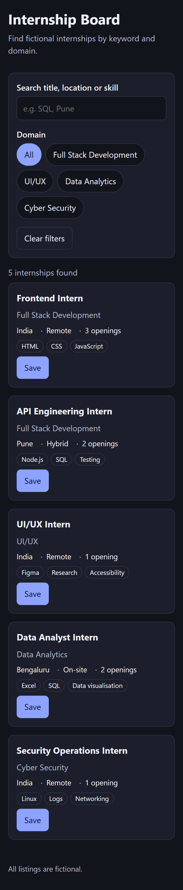
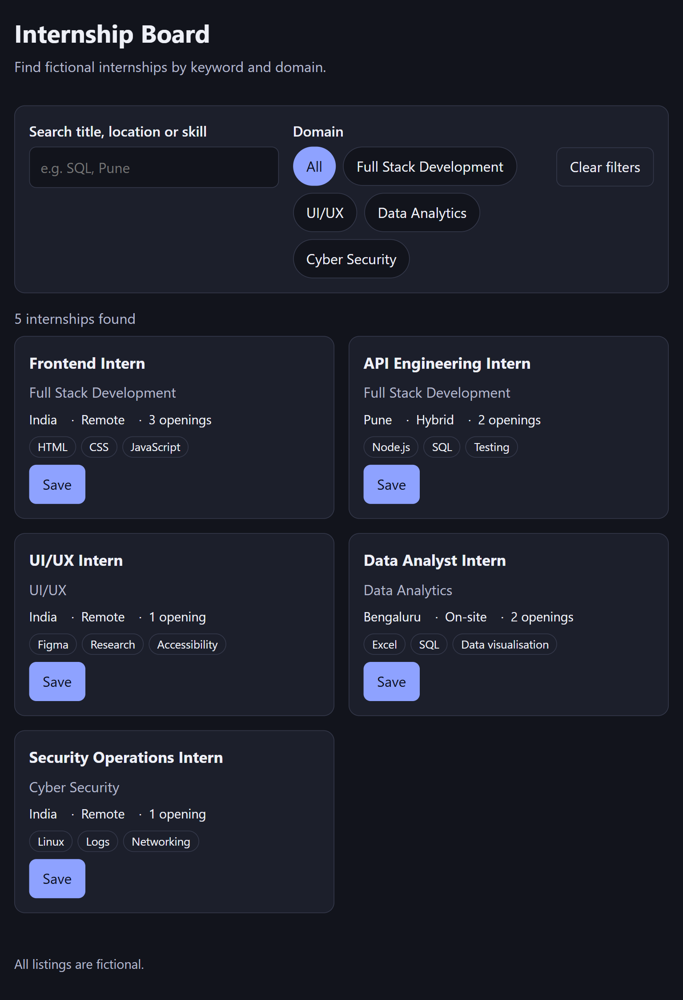
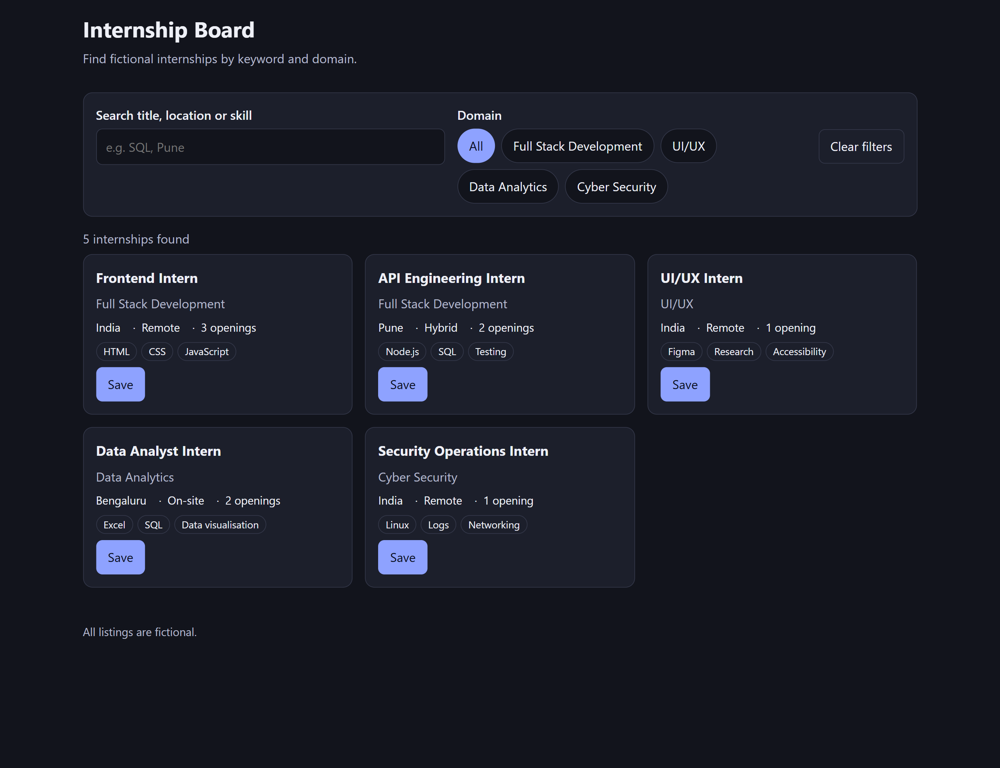
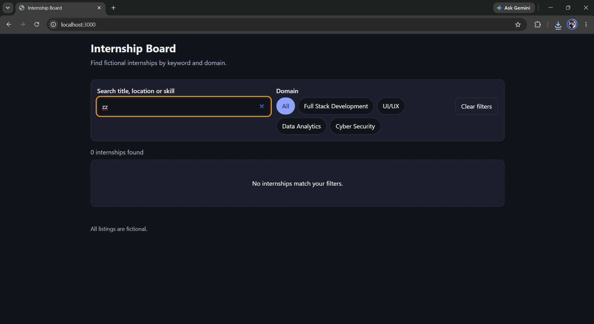

# Responsive Internship Board

An accessible, framework-free internship listing built with semantic HTML, responsive CSS and vanilla JavaScript.

**Live preview:** https://devaprasath213.github.io/internship-board/

## Short explanation

**Page structure (plan):** skip link → header → `main` containing a search form (`role="search"`), a live result count, error and empty states, and a `ul` of internship cards. Each card is an `article` with a heading, domain, location/mode/openings, skill tags and a Save button.

**Reusable card data:** `data/internships.json` (the supplied fictional seed). `app.js` loads it with `fetch`, and a single `card(i)` function renders every record, so adding data needs no HTML changes.

**Search and filters:** keyword search (title, domain, mode, location, skills) combined with domain filter buttons built from the data. "Clear filters" resets both.

**Empty and error states:** "No internships match your filters" when nothing matches; a `role="alert"` message with a Try again button if the JSON fails to load.

**Accessibility:** every control has a label (`label`/`legend`), skip link, visible `:focus-visible` outline, domain chips and Save use `aria-pressed`, result count uses `aria-live="polite"`, content is inserted with `textContent`, 44px tap targets, dark mode and reduced-motion support.

**Responsive layout:** 1 column below 640px, 2 columns from 640px, 3 from 1000px.

## Run locally

`python -m http.server 8000` (or `npx serve`) and open the printed URL. `fetch` does not work from `file://`.

## Responsive test results

| Width | Layout | No horizontal scroll | Keyboard/focus OK | Notes |
|---|---|---|---|---|
| 360px | 1 column | ☑ | ☑ | Cards stack; filter chips wrap; buttons are easy to tap |
| 768px | 2 columns | ☑ | ☑ | Search and domain filters sit side by side |
| 1280px | 3 columns | ☑ | ☑ | Content is centred with a max width of 1100px |

## Screenshots

